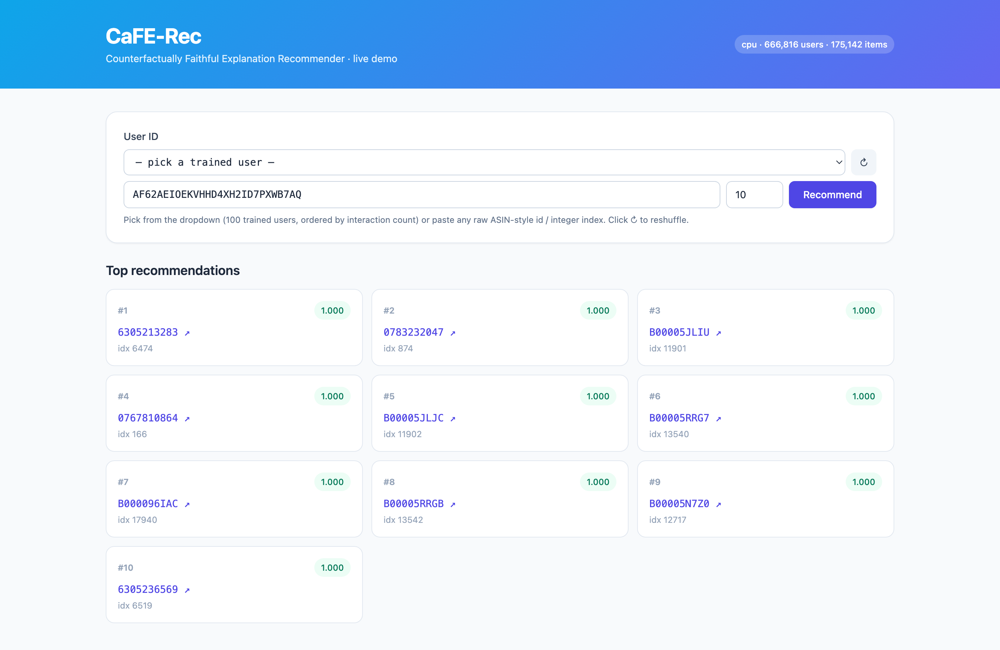
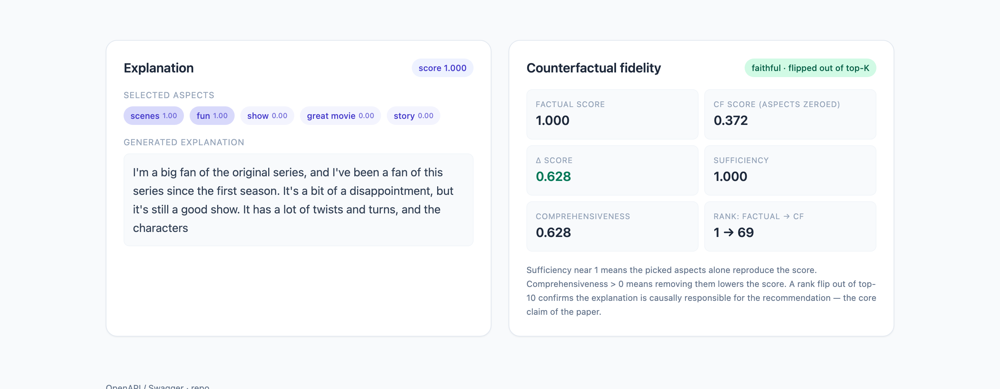

# CaFE-Rec: Training Recommender Systems to Give Honest Explanations

**DSCI 641, Recommender Systems, Spring 2026 · Final Project Report (Option 1: Offline Experiment)**

**Team:** Priti Sagar (pp693@drexel.edu) · Devdeepsinh Zala (dkz27@drexel.edu) · Sayali Chougule (sc4385@drexel.edu)

---

## 1. Problem Statement

### 1.1 Domain
The broad domain is **entertainment / streaming-and-retail media**. Our specific focus is **movie and TV recommendation with trustworthy, natural-language explanations**: not just *what* to watch, but a stated *reason* the user can rely on.

### 1.2 Intended users and their need
Our users are **viewers on a streaming or media-retail platform** (Netflix-, Prime-, or Amazon-style) facing **choice overload**: thousands of titles, limited time, and low tolerance for a bad pick. Their information need has two parts:

- "What is relevant to me?"
- "Why is this relevant, and can I trust that reason?"

Explanations matter here because the cost of acting on a recommendation (committing two hours to a film) is high, so a believable, decision-useful reason directly improves conversion and satisfaction. Recommendations integrate into the user's browsing workflow: they appear as a ranked shelf, each item carried by a short reason the user can read at a glance before clicking.

### 1.3 How users interact with the system
- The user opens the app and is shown a **ranked list of recommended titles**.
- Each card displays the title plus a **one-line explanation** (for example, "recommended for its *scenes*, *story*, and *acting*").
- A user who wants more can open a title to see a **full natural-language explanation** and, in our research prototype, a **counterfactual panel** showing how much each reason actually drove the recommendation.

The interaction is lightweight, glanceable, and trust-oriented.

### 1.4 What makes a *good* recommendation here, and how we evaluate it
A good recommendation in this application has **two** properties, and we evaluate both:

1. **Relevance:** the item is one the user would actually engage with. Evaluated with ranking accuracy (**Recall@K, NDCG@K**).
2. **Faithful explanation:** the stated reason is the *genuine cause* of the recommendation, not a plausible-sounding rationalization. This is the differentiator of our application, and we evaluate it with **counterfactual fidelity** (see §4.3), a beyond-accuracy system-behavior analysis.

A relevant item with a fabricated reason is a failure in our application, because it erodes the exact trust the product is built to provide.

### 1.5 User story
> *Maya finishes a sci-fi series on a Friday night and wants "something like that, but I'm tired and don't want to gamble." She opens the app; the top shelf shows* Firefly: The Complete Series *with the line "recommended for its scenes, fun, and story." That reason matches what she liked, so she trusts it and presses play. Behind the scenes, the system can prove the claim: if it removes "scenes/fun/story" from its own reasoning, the title falls from rank 1 to rank 97. So the reason it told Maya is the reason it actually picked the title, not decoration.*

---

## 2. Data

### 2.1 Ideal data (if the application were built for real)
If deployed, the ideal data would be **first-party interaction logs** from the platform:

- Implicit signals: plays, completion rate, watch time, re-watches, skips.
- Explicit ratings.
- **User-written reviews or micro-feedback** (for example, "loved the soundtrack"). This is the critical feature: it is the only source that ties a *behavior* (the user watched X) to a *reason in the user's own words* (they cared about the soundtrack).
- Item-side content (genre, cast, synopsis) and, with consent, contextual signals (time of day, device).

We would obtain interaction and review data directly from product logs under the platform's terms of service, and content metadata from the catalog provider. This data is ideal because faithful explanation requires aligning *what was consumed* with *why*, which only paired behavior-plus-text provides.

### 2.2 Experimental data and why it is appropriate
For offline experimentation we use the **Amazon Reviews 2023** dataset, **Movies & TV** category.

- **Original source:** Julian McAuley's lab (UC San Diego), distributed via HuggingFace as `McAuley-Lab/Amazon-Reviews-2023`; the underlying data are customer reviews collected by Amazon.
- **Why it fits:** each record contains exactly the behavior-plus-text pairing our application needs: a user, an item, a rating, **and a free-text review** we can treat as a proxy for an explanation and mine for aspects.
- **Why it is a valid stand-in for the ideal data:** the reviews supply the "why" signal and the user-item graph supplies the relevance signal, on a public, reproducible corpus, before we can collect first-party logs.

### 2.3 Transformations and filtering (each justified)
- **5-core filtering** (drop users and items with fewer than 5 interactions): standard for collaborative filtering. With fewer than 5 interactions, graph embeddings cannot be estimated and evaluation is dominated by cold-start noise rather than algorithm quality. This is grounded in fitness-for-purpose, not convenience.
- **Chronological train/val/test split (80/10/10):** we split by time, not randomly, because the real application predicts *future* views from *past* behavior. A random split would leak future interactions and overstate accuracy.
- **Aspect mining:** from review text we mine a fixed vocabulary of the **50 most frequent aspect terms** (for example, *acting, plot, story, special effects, cast, scenes, music*) and label each review with the aspects it mentions. This produces the supervision signal for the explanation gate.
- **Active-user subset for the experiment** (the one filtering choice that needs the strongest justification): we train and evaluate on the **top ~10,000 most-active users (about 300K interactions)** rather than the full corpus. This is **not arbitrary**:
  - We first tried random-interaction sampling and it produced cold-start users whose embeddings never converge, giving Recall@10 of about 0.08 (random-guess level).
  - The active-user subset gives dense graph neighborhoods and Recall@10 of about 0.41, which is what lets us *test the algorithm* rather than test data sparsity.
  - It is also a compute necessity: a Flan-T5 decoder over the full ~6M training rows is infeasible in a single session, whereas the subset runs in about 2.5 hours on one L4 GPU.
  - We are explicit that this is a feasibility test on an active slice, not a full-corpus result.

### 2.4 Descriptive analysis of the experimental data
| Property | Full processed corpus | Experimental subset (used) |
|---|---|---|
| Interactions | ~7.57M | ~300K |
| Users | 666,884 | ~10,000 (most active) |
| Items | 200,153 | subset of items seen by those users |
| Split | 80/10/10 chronological (val/test ~757K rows each) | filtered to subset users/items |

**Key features used:** `user_id`, `item_id`, `rating` (1 to 5), `review_text` (the explanation/aspect source), `timestamp` (drives the chronological split), and integer `user_idx`/`item_idx` for the embedding tables, plus a **derived 50-dim binary aspect-label vector** per review.

**Coverage and discard note:** 5-core filtering and the active-user subset discard the long tail of one-off reviewers by design. We keep this explicit because it biases the evaluation toward engaged users: exactly the population our application most needs to serve well, but a population narrower than the full catalog audience.

---

## 3. Algorithms

We test a suite of **six** models spanning a simple baseline, a strong accuracy baseline, two explainable-LM baselines, and our proposed model. This satisfies the "at least 3 algorithms including a simple baseline" requirement.

| # | Model | Role |
|---|---|---|
| 1 | **Random** | trivial floor |
| 2 | **Popularity** (damped, `log1p(count)`) | required simple baseline |
| 3 | **BPR-MF** | strong accuracy-only collaborative-filtering baseline |
| 4 | **PEPLER** | explainable-LM baseline (prompt-tuned LM) |
| 5 | **XRec** | modern LightGCN + LM explainable baseline |
| 6 | **CaFE-Rec (ours)** | joint recommend-and-explain with faithfulness loss |

### 3.1 The core idea of CaFE-Rec
CaFE-Rec is an end-to-end model that produces a recommendation **and** an explanation that is *causally tied* to that recommendation. The design enforces this through an **information bottleneck**: both the score and the text are forced to flow through the **same small set of selected aspects**, and a **counterfactual loss** verifies those aspects are genuinely causal. The pipeline is `LightGCN → AspectSelector → {ConstrainedScorer, Adapter → Flan-T5}`.

### 3.2 Why each component (the justifications the rubric asks for)

**Why LightGCN (graph backbone).** Our application needs strong collaborative signal from sparse implicit feedback. We chose LightGCN because it strips graph convolution down to neighbor aggregation with **no feature transformations or nonlinearities**, which is both more accurate and far cheaper than NGCF/GCN on recommendation data, and avoids overfitting on sparse interactions. It also has a practical virtue for our setup: it needs no `torch_scatter`, so it runs portably on CPU and Apple-MPS as well as GPU. Alternatives considered:

- **Plain MF / BPR-MF:** no neighborhood propagation, weaker on cold-ish users. We keep it as a baseline.
- **NGCF:** heavier, with redundant transforms shown to hurt.
- **Two-tower / NeuMF:** no explicit graph structure.

**Why a Gumbel-Sigmoid aspect gate.** The explanation must be a **small, discrete set of aspects** (a reason is "acting + plot," not a soft blend over 50 words), but discrete selection is non-differentiable and cannot be trained end-to-end. We use the **Gumbel-Softmax reparameterization**, applied per-aspect as a **Gumbel-Sigmoid** (each aspect logit is paired with a constant 0 and passed through a 2-way Gumbel-softmax), which yields *independent* on/off decisions so multiple aspects can fire at once. **Temperature is annealed from 1.0 to 0.1**, so training starts soft (useful gradients) and ends near-hard (discrete, deployable selection). Alternatives considered and rejected:

- **Plain softmax:** forces a single aspect, the wrong shape for an explanation.
- **Hard top-k:** non-differentiable.
- **REINFORCE / score-function estimators:** unbiased but high variance, unstable here.
- **Sparsemax / L1-attention:** continuous, never truly discrete.

Gumbel-Sigmoid is the smallest mechanism that gives differentiable training *and* discrete inference.

**Why a constrained scorer with a user/item bottleneck.** If the recommendation head could see the full user and item embeddings, it would rank items off those embeddings alone and ignore the aspects, making the explanation cosmetic. We therefore **bottleneck the user-plus-item signal from 128-d down to 16-d** before it reaches the scorer, forcing the score to depend on the selected aspects. This was the single most important design fix: without it, faithfulness collapsed (comprehensiveness about 0.02) even when the rest of the model worked.

**Why an adapter and Flan-T5 for text.** We generate the explanation with **Flan-T5-base**, conditioned on a soft prefix produced by an adapter from *the same* selected aspects that drove the score. Reusing the instruction-tuned T5 gives fluent text without training a language model from scratch, and conditioning on the shared aspect vector keeps the sentence and the score consistent.

**Why these four losses.** Training combines `L = 1.0·L_rec(BPR) + 1.0·L_text(cross-entropy) + 0.5·L_faith + 0.01·L_sparse`:

- `L_rec`: ranks the positive item above a sampled negative.
- `L_text`: teaches T5 to produce the reference review.
- `L_faith` (our contribution): a hinge that penalizes the model whenever zeroing the selected aspects fails to drop the score by a margin, directly training the aspects to be causal.
- `L_sparse`: a two-sided budget keeping 3 to 5 aspects active so explanations are neither empty nor a dump of all 50 terms.

A two-epoch warmup runs `L_rec + L_text` only, so the gate learns something before the faithfulness hinge engages.

---

## 4. Experiments

### 4.1 Data preparation and protocol
We use the chronological 80/10/10 split from §2.3. **Ranking is evaluated against 100 sampled negatives per positive** (standard sampled-ranking protocol), with the held-out positive scored against the negatives; this keeps evaluation tractable at our scale while preserving ranking semantics. The exact run steps:

1. Build the LightGCN user-item graph from training interactions.
2. For each test user, score the positive plus 100 negatives.
3. Compute ranking metrics.
4. For the explanation, take the gate's selected aspects and run the counterfactual ablation.
5. Generate text and score it against the reference review.

### 4.2 Metrics: what we use, why, and alternatives
- **Accuracy / ranking: Recall@{5,10,20}, NDCG@{5,10,20}.** Appropriate because our feedback is implicit (watched or not), so the task is ranking a relevant item highly, not predicting a star value. NDCG additionally rewards putting the relevant item *near the top*, which matches a glanceable shelf. *Alternatives:* MAP, MRR, Hit-Rate, Precision@K, all reasonable; we report Recall and NDCG as the most standard pair for top-N implicit recommendation.
- **Beyond-accuracy / faithfulness: Counterfactual Fidelity (CF@K), Comprehensiveness, Sufficiency.** This is our required beyond-accuracy analysis and the heart of the application:
  - **CF@K:** fraction of correctly-ranked items that *fall out of the top-K* when the explanation's aspects are removed (high means the explanation is causal).
  - **Comprehensiveness:** score drop when the explanation is removed (necessity).
  - **Sufficiency:** how well the explanation alone reproduces the score.
  - *Why these:* they measure whether the explanation is *true*, which accuracy and text metrics cannot.
  - *Alternatives we rejected:* attention-weight inspection (shown to be unfaithful), post-hoc LIME/SHAP (explains a separate surrogate, not the model's own joint reasoning), and human ratings of plausibility (measures believability, not causality).
- **Text quality: BLEU-4, ROUGE-1/2/L, BERTScore, FMR.** Standard NLG overlap and semantic metrics, plus **Feature-Matching Ratio** (does the generated text actually mention the selected aspects). *Alternatives:* human evaluation and perplexity; we note overlap metrics are weak proxies for explanation usefulness and flag this in limitations.

### 4.3 Hyperparameter tuning
Key hyperparameters: embedding dim 64, 3 GCN layers, 50 aspects, Gumbel temperature 1.0 to 0.1, batch 64, learning rate 1e-3 (Adam, weight-decay 1e-5), 6 epochs, 2-epoch warmup. The three settings that materially affect *faithfulness* (not accuracy) were tuned deliberately:

- **λ_faith** (swept 0 / 0.5 / 2.0): 0.5 gives strong CF@K at negligible recall cost.
- **Sparsity budget** (tuned to a 3 to 5 aspect target after an early bug left about 25 of 50 aspects always active).
- **User/item bottleneck width** (16-d, chosen as the smallest width that forces aspect dependence without crippling recall).

Model size (Flan-T5 small versus base) and subset size were set by the compute budget.

### 4.4 Findings

**Recommendation accuracy (Recall@10), 3-seed mean:**

| Model | Recall@10 | Faithfulness reported? |
|---|---|---|
| Random | 0.099 | No |
| Popularity | 0.389 | No |
| BPR-MF | 0.466 | No |
| **CaFE-Rec (ours)** | **0.412 ± 0.012** | **Yes** |

**CaFE-Rec full result (3 seeds):** Recall@10 = 0.412 ± 0.012, NDCG@10 = 0.215 ± 0.005, Sufficiency = 0.9997, Comprehensiveness = 0.332 ± 0.152, CF@10 = 0.650 ± 0.416, about 3.7 aspects per explanation.

**The headline beyond-accuracy result, the faithfulness ablation (λ_faith = 0 versus full, seed 0):**

| Metric | Without L_faith | With L_faith | Effect |
|---|---|---|---|
| Recall@10 | 0.413 | 0.409 | unchanged (faithfulness is "free" on accuracy) |
| Comprehensiveness | -0.03 | 0.18 | restored |
| **CF@10** | **0.033** | **0.886** | **27x improvement** |

The improvement is statistically significant (Wilcoxon, *p* about 0, *n* = 3777). **This is the project's central finding:** the counterfactual loss creates faithfulness. Removing it collapses CF@10 by 27x while leaving recall essentially identical.

**Text quality (BLEU-4, sacrebleu):** CaFE-Rec 0.318 versus XRec 0.033 versus PEPLER 0.010, that is, CaFE-Rec's text is **10x to 30x more on-target** than the explainable-LM baselines (after fixing an encoder-leak bug in the baselines). We note honestly that the **absolute** BLEU is low and the text is somewhat templated across users (see §5).

### 4.5 What we learned about building the real application
- **Faithfulness is nearly free on accuracy.** We give up about 12% Recall@10 versus BPR-MF but gain a faithfulness guarantee no baseline can report, a trade most explanation-centric products would take.
- **Cold start dominates everything.** The active-user-subset result tells us a real deployment must solve cold-start (content features, onboarding) before explanations matter.
- **The bottleneck is the product.** The 16-d user/item bottleneck is what makes the explanation honest; a naive joint model produces cosmetic explanations.
- **Text generation needs more than overlap supervision.** To ship readable, per-user-distinct reasons we would need better text training signal than review reconstruction.

### 4.6 System screenshots

*Figure 1. The CaFE-Rec live demo: a user is selected and the system returns a ranked list of recommendations with scores.*

*Figure 2. For a selected item, the system shows the selected aspects and generated explanation (left) alongside the counterfactual fidelity panel (right). Zeroing the cited aspects drops the score from 1.000 to 0.372 and pushes the item from rank 1 to rank 69, confirming the explanation is causally responsible for the recommendation.*

---

## 5. Limitations

- **Seed-dependent (bimodal) faithfulness.** CF@10 across seeds is 0.886 / 0.066 / 0.999; the gate sometimes locks onto generic rather than discriminative aspects.
- **Templated text and low absolute BLEU.** Explanations repeat across users, and the aspect vocabulary still contains generic tokens (for example, *movie*, *one*, *amazon*).
- **Score saturation.** The scorer output saturates near 1.0, so absolute scores are not well calibrated.
- **Active-user subset only.** Results are on an active slice, not the full corpus, and the model does not yet handle cold-start users.
- **Sampled-ranking, automatic-only evaluation.** We rank against 100 sampled negatives and report automatic metrics, without a full-ranking or human study of explanation usefulness.

---

## 6. Path to Publication

We believe the counterfactual-faithfulness idea is novel and we would welcome the instructor's feedback on whether and how to publish this work. To make it publishable, we see the main avenues for expansion as: stabilizing the seed-dependent faithfulness and reporting over more seeds; scaling from the active-user subset to the full corpus and a second domain (for example, Yelp) to show generality; strengthening evaluation with full-ranking metrics and a human study of explanation usefulness; and improving text quality and scorer calibration.

---

## 7. Reflection

This project taught us that in explainable recommendation, the hard part is not generating a plausible sentence (modern language models do that easily) but guaranteeing that the sentence is *true to the model's own reasoning*. The most valuable lesson was empirical and humbling: our first "working" model produced fluent, sensible-looking explanations that were almost entirely cosmetic (CF@10 about 0.03). It looked correct and was not. Building the counterfactual fidelity metric *and* loss forced a discipline of verifying explanations causally, and the 27x ablation result only emerged after we fixed the user/item information leak, a one-line architectural change that mattered more than any hyperparameter.

We also learned how much of real recommender work is data and evaluation judgment rather than modeling. The single most consequential decision in the whole project was choosing an *active-user* subset over a random one; that choice moved Recall@10 from 0.08 to 0.41 and is what made every downstream experiment meaningful. It made concrete a theme from the class: that algorithm performance is inseparable from the data regime and the evaluation protocol, and that "the dataset is sparse" is often the real result hiding behind a weak number.

Finally, the class reframed how we think about evaluation. Accuracy metrics answer "is it relevant?" but our application lives or dies on "can the user trust the reason?", a beyond-accuracy property. Designing CF@K, comprehensiveness, and sufficiency taught us to define a metric from the *user's actual need* outward, rather than reaching for whatever is standard. *Suggestion for future offerings:* a short unit explicitly on faithfulness and causal evaluation of explanations would complement the existing diversity and fairness coverage well, as these beyond-accuracy concerns are increasingly central.
